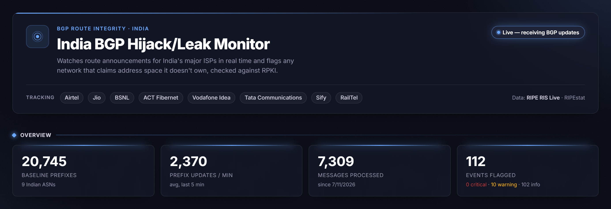
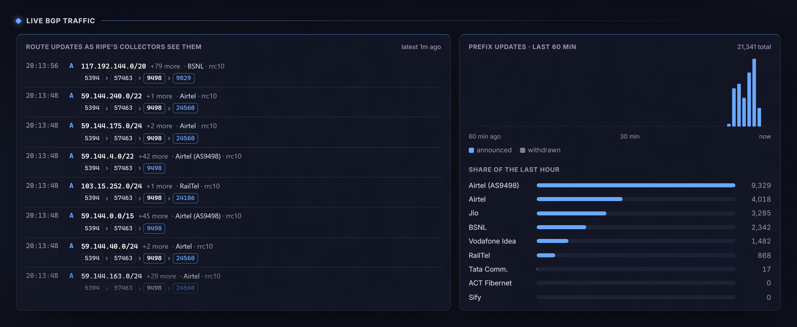
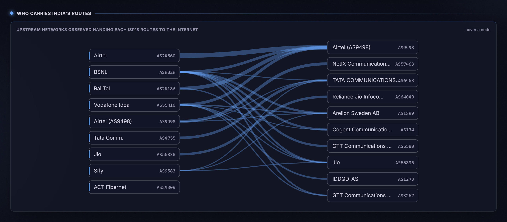
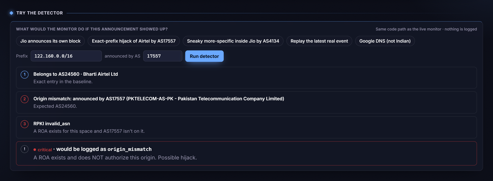
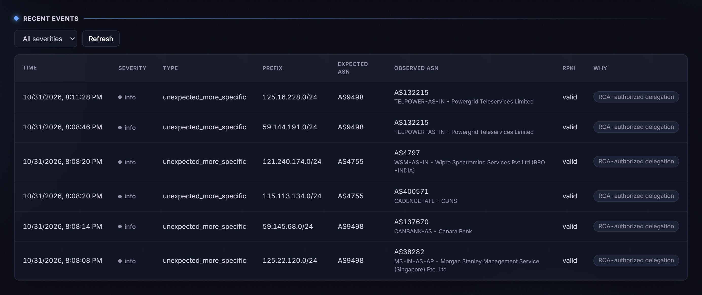

# India BGP Hijack Monitor: Live Route-Integrity Watch for India's Internet

[](https://github.com/HalcyonVector/India-BGP-Hijack-Monitor/actions/workflows/test.yml)

A live monitor for the routing layer of India's internet. It listens to the real global BGP feed from RIPE's route collectors, watches every announcement touching the address space of 9 networks run by India's largest ISPs (Airtel, Jio, BSNL, ACT Fibernet, Vodafone Idea, Tata Communications, Sify and RailTel), and flags any announcement whose origin isn't the network that owns that space. Each flag is graded by RPKI: authorized by a ROA, unverifiable, or actively rejected. Every other update for that space is recorded too, so the dashboard shows the real traffic the detector is reading, not just the rare alarms.

Built with FastAPI, SQLite and a single-file vanilla JS dashboard, entirely on free, keyless public data (RIPE RIS Live and RIPEstat), running for $0/month on Render and GitHub Pages.

> **What it's for:** leave it open and watch real route updates for Indian address space stream past, hop by hop, with every one checked against who should be announcing it. Or type in any prefix and AS number and see exactly what the detector would decide, and why.

**Live demo:** [halcyonvector.github.io/India-BGP-Hijack-Monitor/frontend](https://halcyonvector.github.io/India-BGP-Hijack-Monitor/frontend/) (backend on Render's free tier, which sleeps when idle, so the first load can take ~30s)



---

## Disclaimer

This project is for personal and educational use. It is **not a production security tool, an incident-response system, or an authoritative source on the state of Indian routing**, and makes no claims to that effect. Detection covers the ~8 largest blocks per tracked network, not every prefix (see Honest Limitations). It has been run against real BGP traffic, where every flag so far has been RPKI-authorized or unverifiable rather than a hijack, and unit-tested against fabricated hijacks, but it has not caught a real hijack, because none happened while it was watching. No credentials, no paid APIs and no outbound alerting anywhere in this project.

---

## Findings

Real results from running this, not projections:

- **The first version never checked a single prefix.** The monitor read `announcement["prefix"]`, but RIS Live sends `announcement["prefixes"]` (a list). Every message raised a `KeyError` that websocket-client silently swallowed, so the early "zero false positives" result really meant zero checks. Fixed, and handler errors are now logged loudly.
- **Once it actually ran, a "wrong" origin was usually fine.** In a ~15-minute live run (~48,000 prefix updates), most mismatched origins were Indian businesses (Canara Bank, Powergrid, Wipro, Morgan Stanley's India arm) announcing sub-blocks of their ISP's space, each **explicitly authorized by an RPKI ROA**. These are graded `info`. What's left as `warning` is the genuinely unverifiable case, such as AS135709 (Lightstorm) originating a /24 inside Sify's space with no ROA either way.
- **"Critical" could never fire.** RIPEstat reports `invalid_asn` / `invalid_length`, never a bare `invalid`, so the original `== "invalid"` check never matched. A Pakistan Telecom (AS17557) announcement of Airtel's block now correctly comes out **critical**.
- **Airtel announces its own space from two ASNs.** AS24560 and AS9498 are both Bharti Airtel, and early runs flagged them as hijacking each other. They're now treated as siblings. Over 109 daily snapshots (July to October 2026), AS24560's announced prefix count fell by 270 while AS9498's rose by 130.
- **RPKI adoption is uneven.** In the latest 30-prefix-per-network sample, Airtel's AS24560 has ROAs for **63%** of its prefixes, while Jio, BSNL and Vodafone Idea are at **100%** and everyone else is between 87% and 97%. RPKI can strongly back up a flag for some networks and barely help for others.

---

## Features

### Core Detection

- **Prefix-filtered, not path-filtered**, subscription to RIPE RIS Live. A hijacker's AS path never contains the victim's ASN, so filtering by path would miss exactly the announcements that matter.
- **Baseline comparison:** each tracked network's currently-announced prefixes (from RIPEstat) are the ground truth. The covering prefix for any announcement is found by walking up its supernets (at most 32 lookups for IPv4), not by scanning all ~21k networks.
- **More-specific detection:** `moreSpecific: true` subscriptions catch a /24 carved out of a normally-/16 block, not just exact-prefix mismatches.
- **RPKI grading on every flag:** ROA authorizes the origin → `info`, no ROA → `warning`, ROA rejects the origin (`invalid_asn` / `invalid_length`) → `critical`.
- **Sibling networks** of the same company (Airtel's AS24560 / AS9498) count as the same owner.
- **Repeat suppression:** the same (prefix, origin) is logged once per 6 hours, not on every re-announcement.
- **Named offenders:** the observed origin is resolved to its holder organisation (RIPEstat as-overview), not left as a bare number.

### Live Traffic

- **Live BGP feed:** real route updates as RIPE's collectors see them, each AS path drawn hop by hop with the origin highlighted, plus which collector heard it.
- **Per-minute activity chart** of announcements vs. withdrawals over the last hour, and each network's share of that traffic.
- **Who Carries India's Routes:** an interactive graph of the upstream networks (Arelion, Cogent, GTT, Tata and others) observed handing each ISP's routes to the rest of the internet. Hover a network to isolate its links.
- **Per-ISP cards** with a 60-minute activity sparkline, top upstream and RPKI coverage.





### Try the Detector

- Type any prefix and origin ASN, or pick a preset (Jio announcing its own block, a Pakistan Telecom-style hijack of Airtel, a China Telecom-style more-specific inside Jio, a replay of the latest real event, or Google DNS as out-of-scope space).
- Steps through exactly what the live monitor would decide, using the same code path, including a live RPKI lookup. Nothing is logged.



### Baseline Drift & RPKI Coverage

- **Baseline drift:** per-network prefix count change between the oldest and newest daily baseline snapshot, with a trend line of the total. Read from a committed history file, so it needs no network calls and has no rate limit.
- **RPKI coverage:** samples 30 baseline prefixes per network and reports what fraction have a ROA at all, labelled on the dashboard as a sample, not an exhaustive figure.

### Events

- Every flag with its severity, type (exact or more-specific), expected vs. observed origin, RPKI status and a short "why" tag (full explanation on hover). Filterable by severity; the first 12 rows show, with the rest one click away.



### UI/UX: "Quiet Control Room"

A dark, matte dashboard with one accent colour. Everything is blue or a shade of white, and amber and red appear only when something is actually wrong, so a warning is never lost among decorative colour. The heading card, stat tiles and panels share one surface style: mostly opaque, softly lit from behind, with a faint grain instead of glossy glass. Type is Inter, with monospace for prefixes, AS numbers and paths.

### Resilience & Accessibility

- Auto-refreshes every 15s. A failed poll keeps the last good data on screen, and a banner appears only after repeated failures.
- Sections re-render only when their data actually changes, and auto-updating regions are `aria-live` so screen readers announce real updates.
- Respects `prefers-reduced-motion`. Every value from the API is HTML-escaped before rendering.
- Works down to phone width with no horizontal scrolling; the wide events table scrolls inside its own card.

---

## Data Source

| Source | Type | API Key? | What It Provides |
|--------|------|----------|-------------------|
| [RIPE RIS Live](https://ris-live.ripe.net/) | Real-time WebSocket | No | Live BGP UPDATE messages from RIPE's route collectors, filtered server-side by prefix |
| [RIPEstat](https://stat.ripe.net/docs/data_api) announced-prefixes | REST | No | Each network's currently-announced prefixes (the baseline) |
| RIPEstat rpki-validation | REST | No | ROA status: `valid`, `invalid_asn`, `invalid_length` or `unknown` |
| RIPEstat as-overview | REST | No | Holder organisation for an AS number |

---

## Tech Stack

| Layer | Technology | Details |
|-------|-----------|---------|
| **Backend** | FastAPI + Uvicorn | Read-only REST API, OpenAPI docs at `/docs` |
| **Live data** | websocket-client | RIS Live subscription, run inline as a background thread on Render |
| **HTTP** | requests | RIPEstat calls; holder-name lookups on their own throttled thread |
| **Database** | SQLite | No external database; live tables are bounded (24h of per-minute counts, newest 300 updates) |
| **Frontend** | Vanilla HTML/CSS/JS | One file, no framework, no build step; hand-drawn SVG chart and graph |
| **Testing** | FastAPI TestClient (httpx2) | Endpoint tests plus fixture-based detection tests |
| **CI / Scheduling** | GitHub Actions | Tests on every push; daily baseline and weekly RPKI refresh jobs commit their results |
| **Hosting** | Render (free) + GitHub Pages | $0/month |

---

## Prerequisites

- **Python 3.11+**: [Download here](https://www.python.org/downloads/)

No API keys, no accounts, no paid services.

---

## Quick Start

```bash
pip install -r requirements.txt
python db/store.py                          # create the schema
python backend/detector/baseline.py         # build the real baseline (~21k prefixes, 9 networks)
python backend/detector/monitor.py          # run the live monitor (Ctrl+C to stop)
```

In two more terminals:

```bash
python -m uvicorn backend.api:app --port 8000
python -m http.server 8090 --directory frontend
```

Open `http://localhost:8090`. API docs are at `http://localhost:8000/docs`.

### Production

Render runs the API and the monitor in one free web service (`render.yaml`), and GitHub Pages serves the dashboard. Step-by-step guide, free-tier trade-offs and the sleep workaround are in [docs/deployment.md](docs/deployment.md). To keep the monitor running on your own Windows machine instead, see [docs/scheduling.md](docs/scheduling.md).

### Tests

```bash
python backend/detector/test_detection_logic.py   # detection logic: 8 checks
python backend/test_api.py                         # API endpoints: 11 checks
```

---

## Project Structure

```
India-BGP-Hijack-Monitor/
├── README.md
├── LICENSE
├── requirements.txt
├── render.yaml                         # Render Blueprint: one free web service
├── run_monitor.bat                     # Restart-on-crash wrapper for a persistent local monitor
├── .github/workflows/
│   ├── test.yml                        # Both test suites on every push
│   ├── refresh-baseline.yml            # Daily: rebuild baseline, append to history, commit
│   └── refresh-rpki-coverage.yml       # Weekly: resample RPKI coverage, commit
│
├── backend/
│   ├── api.py                          # FastAPI app (+ inline monitor/RPKI threads on Render)
│   ├── test_api.py                     # Endpoint tests
│   └── detector/
│       ├── targets.py                  # Tracked networks and sibling groups
│       ├── baseline.py                 # Announced prefixes per network (RIPEstat)
│       ├── monitor.py                  # RIS Live listener: classify, grade, record activity
│       ├── rpki_coverage.py            # Sampled ROA coverage per network
│       ├── baseline_drift.py           # Drift from docs/baseline-history.json
│       └── test_detection_logic.py     # Fixture-based detection tests
│
├── db/
│   ├── schema.sql                      # Baseline, events, live activity, upstreams, names
│   └── store.py                        # Connection, schema init, bounded writes
│
├── frontend/
│   └── index.html                      # The whole dashboard (deploy-aware API URL)
│
├── scripts/
│   └── seed_baseline_history.py        # One-off: rebuilt the drift history from git
│
└── docs/
    ├── deployment.md                   # Render + GitHub Pages guide
    ├── scheduling.md                   # Running the monitor as a Windows background task
    ├── limitations.md                  # Full list of limitations and past bugs
    ├── baseline-summary.json           # Latest baseline counts (committed daily)
    ├── baseline-history.json           # Every daily snapshot (read by /api/baseline-drift)
    ├── rpki-coverage-summary.json      # Latest RPKI sample (committed weekly)
    └── screenshots/                    # README images
```

---

## API Endpoints

| Method | Endpoint | Description |
|--------|----------|-------------|
| GET | `/api/status` | Messages processed, event counts by severity, baseline size, last message time |
| GET | `/api/asns` | Tracked networks with baseline prefix counts, RPKI coverage and a sample prefix |
| GET | `/api/events` | Recent events. Optional `severity` and `limit` (default 50, max 500) |
| GET | `/api/live` | Rolling feed of real updates, per-network per-minute activity (last 60 min) and observed upstreams |
| GET | `/api/check?prefix=&origin=` | Runs the detection logic on a hypothetical announcement. Read-only; nothing is logged |
| GET | `/api/baseline-drift` | Per-network prefix count drift across the committed daily snapshots |

---

## Configuration

| Variable | Default | Description |
|----------|---------|-------------|
| `RUN_MONITOR_INLINE` | unset | `1` starts the live monitor as a background thread inside the API process (used on Render) |
| `RUN_RPKI_REFRESH_INLINE` | unset | `1` re-samples RPKI coverage in the background on boot (~5 min) |

The tracked networks live in `backend/detector/targets.py` as a plain dict. The dashboard picks its API URL automatically (localhost vs. Render).

---

## Architecture

```
                 ┌───────────────────────────────────┐
                 │   Dashboard (GitHub Pages / :8090) │
                 │   vanilla HTML/CSS/JS, polls 15s   │
                 └─────────────────┬─────────────────┘
                                   │ REST
                 ┌─────────────────▼─────────────────┐
                 │   FastAPI (Render / :8000)          │
                 │   status · asns · events · live      │
                 │   check · baseline-drift             │
                 └───────┬───────────────────┬────────┘
                         │                   │
              ┌──────────▼─────────┐  ┌──────▼──────────────────┐
              │ SQLite               │  │ docs/*.json (committed  │
              │ baseline · events ·  │  │ by GitHub Actions):     │
              │ activity · updates · │  │ baseline history,       │
              │ upstreams · names    │  │ RPKI sample             │
              └──────────▲─────────┘  └─────────────────────────┘
                         │ writes
              ┌──────────┴──────────────────────────────┐
              │ monitor.py (thread on Render)             │
              │ RIS Live WebSocket → classify → RPKI grade │
              └──────────┬─────────────────┬─────────────┘
                         │                 │
                ┌────────▼───────┐  ┌──────▼─────────────┐
                │ RIPE RIS Live    │  │ RIPEstat            │
                │ (BGP updates)    │  │ RPKI · holder names │
                └──────────────────┘  └────────────────────┘
```

How a single announcement is handled:

1. **Baseline:** each network's announced prefixes are loaded from RIPEstat (rebuilt daily in CI).
2. **Subscribe:** RIS Live is filtered to the ~8 largest blocks per network, with `moreSpecific: true`.
3. **Classify:** find the covering baseline prefix and its owner. A different origin (that isn't a sibling) becomes an event, graded by RPKI.
4. **Record:** every update for tracked space also feeds the bounded activity, feed and upstream tables that drive the live panels.

---

## Testing

```bash
python backend/detector/test_detection_logic.py
python backend/test_api.py
```

**Detection logic (8 checks):** a legitimate exact match, a legitimate sub-prefix, a fabricated exact-prefix hijack, a fabricated sub-prefix hijack, unrelated space ignored, RPKI severity grading against RIPEstat's real status strings, AS-path upstream extraction (with prepending collapsed), and Airtel's sibling ASN not being flagged.

**API (11 checks), against the real FastAPI app:** response shapes, severity filtering, `limit` validation (over-max is rejected, not silently capped), drift always reporting a status, the `/api/live` shape, and `/api/check` verdicts: Jio's own block isn't flagged, a fabricated sub-prefix hijack is, and untracked space and bad input are handled.

Neither suite needs live traffic or API keys. Both run in CI on every push, and the detection suite runs again daily against the freshly rebuilt baseline.

---

## Honest Limitations

Full detail, including past bugs and how they were found, in [docs/limitations.md](docs/limitations.md).

- **Coverage is partial by design.** The monitor subscribes to the ~8 largest blocks per network (72 in total). A hijack of space entirely outside them would be missed.
- **It detects origin hijacks, not route leaks.** It checks *who originates* a prefix. A leak where the origin is correct but the path is wrong (a network re-announcing routes it shouldn't) isn't detected.
- **It hasn't caught a real hijack.** Recall is tested with fabricated fixtures; precision has been tested against real traffic. Those are different claims, and only the second has been seen live.
- **RPKI coverage figures are a 30-prefix sample per network**, not an exhaustive count, and refresh weekly.
- **Render's free tier has no persistent disk.** A restart wipes events and live activity. The baseline and RPKI coverage rebuild themselves on boot; event history genuinely resets, and no fake history is seeded to hide that.
- **One collector, no redundancy.** The monitor is a single process on a single machine.
- **No outbound alerting.** The dashboard is the only output.
- **The scheduled GitHub Actions jobs don't always fire on time**, which can delay a baseline refresh by hours (see docs/limitations.md).

---

## Suggested Future Features

- **Route-leak detection:** flag valley-free violations in AS paths, not just origin mismatches.
- **Full-prefix coverage**, by splitting subscriptions across several RIS Live connections.
- **Alerting** via a free channel (an RSS feed or email digest) for `warning` and `critical` events.
- **Durable event history** in a free hosted database, so a Render restart doesn't erase it.
- **More Indian networks**, and sibling groups for other multi-ASN companies.
- **An events timeline** that groups related announcements into one incident.

---

## Author

**Sagnik**

GitHub: [@HalcyonVector](https://github.com/HalcyonVector)

---

## 📄 License

MIT License. See [LICENSE](./LICENSE). Free to use, modify, and distribute, with no warranty.
