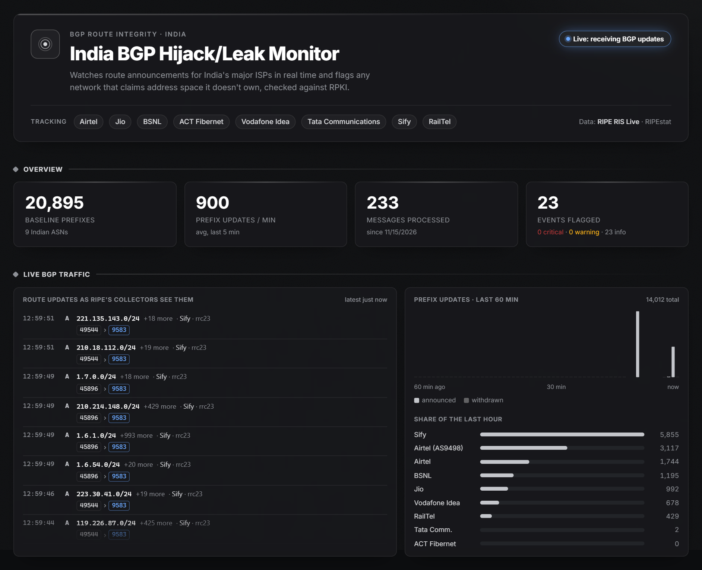
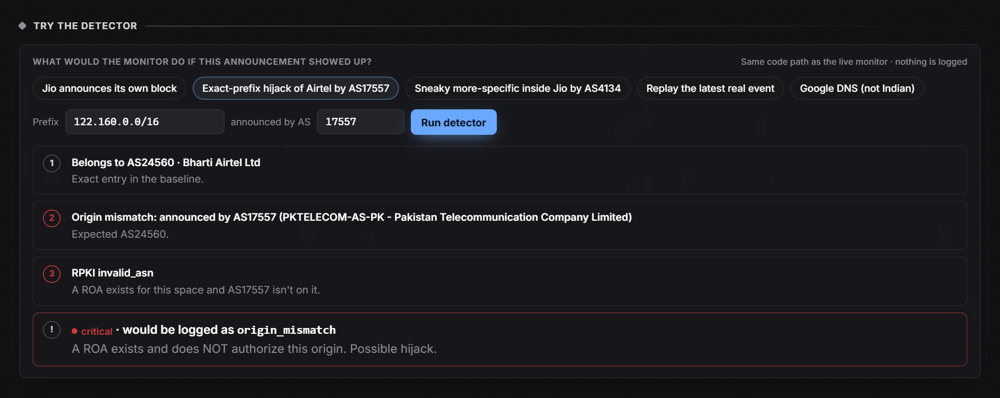

# India BGP Hijack Monitor: Live Route-Integrity Watch for India's Internet

Who is announcing India's address space right now, and should they be? This project answers that from the real global routing feed. It reads every BGP announcement RIPE's route collectors hear for the address space of 9 networks run by India's largest ISPs (Airtel, Jio, BSNL, ACT Fibernet, Vodafone Idea, Tata Communications, Sify and RailTel), joins each one against a daily baseline of who normally originates that space, and grades any mismatch with RPKI: authorized by a ROA, unverifiable, or actively rejected. It also flags paths shaped like route leaks. A scheduled job watches the feed for 20 minutes four times a day and commits what it saw, so the analysis rests on a growing dataset: who announces inside whose space, how much churn each network sees, how RPKI coverage compares across networks (pooled over 20 weekly samples) and how the announced space drifts (122 daily snapshots since July 2026). The detector is also replayed over RIPE's raw archives of four documented incidents to check that it catches real hijacks and leaks, not just fabricated ones.

Built with Python (FastAPI, SQLite) and a single-file vanilla JS dashboard on keyless public data (RIPE RIS Live, RIPEstat and the RIS raw update archives).

> **What it's for:** watching real route updates for Indian address space stream past, hop by hop, with every one checked against who should be announcing it, and testing any prefix and AS number against the same detector to see exactly what it would decide and why.

**Live demo:** [halcyonvector.github.io/India-BGP-Hijack-Monitor/frontend](https://halcyonvector.github.io/India-BGP-Hijack-Monitor/frontend/) (the page shows the most recent saved data at once, then switches to live data when the backend wakes, which can take up to a minute)





---

## Disclaimer

This project is for personal and educational use. It is **not a production security tool, an incident-response system, or an authoritative source on the state of Indian routing**, and makes no claims to that effect. Detection covers the ~8 largest blocks per tracked network, not every prefix (see Honest Limitations). It has been run against real BGP traffic, where every flag so far has been RPKI-authorized or unverifiable rather than a hijack. Replayed over archived data it caught 3 of 4 documented incidents, but it has not caught a live hijack of Indian space, because none has happened while it was watching. The route-leak check is a heuristic. No credentials, no paid APIs and no outbound alerting anywhere in this project.

---

## Findings

Real results from running this, not projections:

- **The first version never checked a single prefix.** The monitor read `announcement["prefix"]`, but RIS Live sends `announcement["prefixes"]` (a list). Every message raised a `KeyError` that websocket-client silently swallowed, so the early "zero false positives" result really meant zero checks. Fixed, and handler errors are now logged loudly.
- **Once it actually ran, a "wrong" origin was usually fine.** In a ~15-minute live run (~48,000 prefix updates), most mismatched origins were Indian businesses (Canara Bank, Powergrid, Wipro, Morgan Stanley's India arm) announcing sub-blocks of their ISP's space, each **explicitly authorized by an RPKI ROA**. These are graded `info`. What's left as `warning` is the genuinely unverifiable case, such as AS135709 (Lightstorm) originating a /24 inside Sify's space with no ROA either way.
- **"Critical" could never fire.** RIPEstat reports `invalid_asn` / `invalid_length`, never a bare `invalid`, so the original `== "invalid"` check never matched. A Pakistan Telecom (AS17557) announcement of Airtel's block now correctly comes out **critical**.
- **Airtel announces its own space from three ASNs.** AS24560, AS9498 and AS45609 (its mobile network) are all Bharti Airtel, and runs flagged them as hijacking each other. They're now treated as siblings. Over 122 daily snapshots (11 July to 14 November 2026), AS24560's announced prefix count fell by 266 while AS9498's rose by 147, so space is moving between Airtel's own ASNs rather than disappearing.
- **RPKI adoption is uneven, and one network stands apart.** Pooling all 20 weekly samples (600 prefixes per network, July to November 2026), Airtel's AS24560 has ROAs for **51.3%** of its prefixes (95% CI 47.3 to 55.3%). Every other network is between **90.5%** (Sify) and **99.5%** (Jio, BSNL). Single weeks put AS24560 anywhere from 37% to 67%; that swing is sampling noise from 30-prefix samples, not real change, which is why the dashboard pools them. RPKI can strongly back up a flag for most networks and only half the time for Airtel's main one.
- **The detector catches real incidents in archived data.** Replayed over RIPE RIS's raw update files, it flagged Pakistan Telecom's 2008 YouTube hijack at 18:47:57 UTC (seen by 11 collector peers), all five of eNet's 2018 Route 53 /24s, and the 2019 Verizon leak with **AS396531 named as the leaker** across 62 prefixes and 24 peers. It **missed** the 2024 incident around Cloudflare's 1.1.1.1: the /32 hijack never reached a RIS collector, and the leak that did runs between regional networks with no Tier-1 on both sides, which the leak heuristic can't see.
- **The tracked space is stable overall but not static.** Across the same 122 snapshots the total baseline grew from 20,737 to 20,895 prefixes (+158), with BSNL adding 131 and Sify unchanged at 2,225.

---

## Features

### Core Detection

- **Prefix-filtered, not path-filtered**, subscription to RIPE RIS Live. A hijacker's AS path never contains the victim's ASN, so filtering by path would miss exactly the announcements that matter.
- **Baseline comparison:** each tracked network's currently-announced prefixes (from RIPEstat) are the ground truth. The covering prefix for any announcement is found by walking up its supernets (at most 32 lookups for IPv4), not by scanning all ~21k networks.
- **More-specific detection:** `moreSpecific: true` subscriptions catch a /24 carved out of a normally-/16 block, not just exact-prefix mismatches.
- **RPKI grading on every flag:** ROA authorizes the origin → `info`, no ROA → `warning`, ROA rejects the origin (`invalid_asn` / `invalid_length`) → `critical`.
- **Sibling networks** of the same company (Airtel's AS24560, AS9498 and mobile AS45609) count as the same owner.
- **Repeat suppression:** the same (prefix, origin) is logged once per 6 hours, not on every re-announcement.
- **Named offenders:** the observed origin is resolved to its holder organisation (RIPEstat as-overview), not left as a bare number.
- **Route-leak heuristic:** a path where a network that isn't Tier-1 sits between two Tier-1 backbones (for example `701 > 396531 > 33154 > 3356`) is logged as a possible leak, naming the network that handed the route upward. One event per leaker and network per 6 hours, since one leak re-announces hundreds of prefixes.

### Live Traffic

- **Live BGP feed:** real route updates as RIPE's collectors see them, each AS path drawn hop by hop with the origin highlighted, plus which collector heard it.
- **Per-minute activity chart** of announcements vs. withdrawals over the last hour, and each network's share of that traffic.
- **Who Carries India's Routes:** an interactive graph of the upstream networks (Arelion, Cogent, GTT, Tata and others) observed handing each ISP's routes to the rest of the internet. Hover a network to isolate its links.
- **Per-ISP cards** with a 60-minute activity sparkline, top upstream and RPKI coverage.


### Try the Detector

- Type any prefix and origin ASN, or pick a preset (Jio announcing its own block, a Pakistan Telecom-style hijack of Airtel, a China Telecom-style more-specific inside Jio, a replay of the latest real event, or Google DNS as out-of-scope space).
- Steps through exactly what the live monitor would decide, using the same code path, including a live RPKI lookup. Nothing is logged.


### Captured History

- **A dataset, not a moment:** GitHub Actions runs the monitor for 20 minutes four times a day and commits a daily summary and every distinct flag (90 days kept) to `docs/history/`.
- **Distinct flags per day by severity**, with hours watched and messages processed, so a quiet day and an unwatched day aren't confused.
- **Route churn per 1,000 prefixes:** prefix updates per hour watched, normalised by each network's size, so a big ISP doesn't look busy just for being big.

### Who Announces Inside Whose Space

- Every origin seen announcing inside a tracked ISP's space, grouped by network: how many prefixes, how many are ROA-authorised, unverifiable or invalid, and how many captures saw it. Most are business customers using space their ISP assigned them; the table leads with the ones RPKI can't vouch for.
- Possible route leaks get their own table with the Tier-1 > network > Tier-1 path.

### RPKI Coverage, Pooled Over Weeks

- Each network's weekly samples as a strip of ticks, with the pooled estimate and its 95% Wilson confidence interval, sorted worst first.

### Baseline Drift

- Per-network prefix count change between the oldest and newest daily baseline snapshot, with a trend line of the total.

### Tested Against Real Incidents

- Four documented incidents replayed through the same detection functions, each with when it was first flagged, how many collector peers saw it, an example path and a link to the write-up. The miss is shown as a miss, with the reason.

### Events

- What the live server has flagged since it last woke: severity, type (exact, more-specific or possible leak), expected vs. observed AS, RPKI status and a short "why" tag (full explanation on hover). Filterable by severity; the first 12 rows show, with the rest one click away.


### UI/UX: "Quiet Control Room"

A dark, matte, mostly neutral dashboard. Data is drawn in light grey, blue is kept for what is live or clickable (the live badge, the origin AS in each path, the Run detector button), and amber and red appear only when something is actually wrong, so a warning is never lost among decorative colour. Type is Inter, with monospace for prefixes, AS numbers and paths.

### Resilience & Accessibility

- Shows saved data on first paint (the visitor's last session, or the snapshot from the last 20-minute capture), labelled with its age, while the backend wakes. It stays until the woken server has real data to replace it, so the page never drops to an empty view.
- The analysis panels read committed files straight from GitHub Pages, so they never wait for, or wake, the backend.
- Auto-refreshes every 15s without stacking requests. A failed poll keeps the last good data on screen, and a banner appears only after repeated failures.
- Sections re-render only when their data actually changes, and auto-updating regions are `aria-live` so screen readers announce real updates.
- Respects `prefers-reduced-motion`. Every value from the API is HTML-escaped before rendering.
- Works down to phone width with no horizontal scrolling; the wide events table scrolls inside its own card.

---

## Data Source

| Source | Type | API Key? | What It Provides |
|--------|------|----------|-------------------|
| [RIPE RIS Live](https://ris-live.ripe.net/) | Real-time WebSocket | No | Live BGP UPDATE messages from RIPE's route collectors, filtered server-side by prefix |
| [RIPEstat](https://stat.ripe.net/docs/data_api) announced-prefixes | REST | No | Each network's currently-announced prefixes (the baseline) |
| RIPEstat rpki-validation | REST | No | ROA status: `valid`, `invalid_asn`, `invalid_length` or `unknown` |
| RIPEstat as-overview | REST | No | Holder organisation for an AS number |
| [RIPE RIS raw data](https://data.ris.ripe.net/) | MRT update files (archive since 1999) | No | What collectors recorded during past incidents, for the replay |

**How the data is cleaned and joined:**

1. **Baseline:** RIPEstat's announced prefixes for each tracked ASN are stored as (prefix, owner ASN) and rebuilt daily. Airtel's three ASNs form one sibling group so they never flag each other.
2. **Stream:** each RIS Live message is split into one row per prefix (a message carries a list), the origin is the last AS in the path with prepending collapsed, and AS sets are skipped.
3. **Join:** each announced prefix is matched to its covering baseline prefix by walking up its supernets (at most 32 lookups for IPv4). No covering prefix means untracked space, which is ignored.
4. **Grade:** a mismatched origin is checked with RIPEstat's RPKI validator and graded `info`, `warning` or `critical`; the same (prefix, origin) is recorded once per 6 hours.
5. **Aggregate:** every tracked update also feeds per-minute counts, a rolling feed and the upstream (second-to-last hop) edges behind the live panels.
6. **History:** each capture adds its minutes watched, messages and per-network update counts to that UTC day, and counts a flag once per day by its (prefix, origin) key, or (leaker, network) for leaks. Churn divides updates by hours watched and by the network's latest baseline size.
7. **RPKI pooling:** weekly samples are independent random draws of 30 prefixes, so counts are summed across weeks and given a Wilson score interval.

---

## Tech Stack

| Layer | Technology | Details |
|-------|-----------|---------|
| **Backend** | FastAPI + Uvicorn | Read-only REST API, OpenAPI docs at `/docs` |
| **Live data** | websocket-client | RIS Live subscription, run inline as a background thread on Render |
| **HTTP** | requests | RIPEstat calls; holder-name lookups on their own throttled thread |
| **Database** | SQLite | No external database; live tables are bounded (24h of per-minute counts, newest 300 updates) |
| **Frontend** | Vanilla HTML/CSS/JS | One file, no framework, no build step; hand-drawn SVG chart and graph |
| **Testing** | FastAPI TestClient (httpx2) | Endpoint tests plus fixture-based detection tests |
| **CI / Scheduling** | GitHub Actions | Tests on every push; 20-minute captures four times a day, a daily baseline and a weekly RPKI sample, each committing its results |
| **Replay** | mrtparse | Reads RIS MRT archive files for the incident replay (only that script needs it) |
| **Hosting** | Render + GitHub Pages | Backend on Render, static frontend on GitHub Pages |

---

## Prerequisites

- **Python 3.11+**: [Download here](https://www.python.org/downloads/)

No API keys, no accounts, no paid services.

---

## Quick Start

```bash
pip install -r requirements.txt
python db/store.py                          # create the schema
python backend/detector/baseline.py         # build the real baseline (~21k prefixes, 9 networks)
python backend/detector/monitor.py          # run the live monitor (Ctrl+C to stop)
```

In two more terminals:

```bash
python -m uvicorn backend.api:app --port 8000
python -m http.server 8090
```

Open `http://localhost:8090/frontend/` (served from the repo root, as GitHub Pages does, so the dashboard can read `docs/`). API docs are at `http://localhost:8000/docs`.

### Production

To deploy your own copy (Render for the API, GitHub Pages for the dashboard), follow [docs/deployment.md](docs/deployment.md). To keep the monitor running on your own Windows machine instead, see [docs/scheduling.md](docs/scheduling.md).

### Tests

```bash
python backend/detector/test_detection_logic.py   # detection logic: 10 checks
python backend/test_api.py                         # API endpoints: 11 checks
```

### Analysis jobs

```bash
python scripts/capture.py --minutes 20          # watch the feed and add to docs/history/
pip install mrtparse && python scripts/replay_incidents.py   # replay the four incidents
```

---

## Project Structure

```
India-BGP-Hijack-Monitor/
├── README.md
├── LICENSE
├── requirements.txt
├── render.yaml                         # Render Blueprint: one free web service
├── run_monitor.bat                     # Restart-on-crash wrapper for a persistent local monitor
├── .github/workflows/
│   ├── test.yml                        # Both test suites on every push
│   ├── capture.yml                     # 4x a day: watch RIS Live 20 min, commit history + snapshot
│   ├── refresh-baseline.yml            # Daily: rebuild baseline, append to history, commit
│   └── refresh-rpki-coverage.yml       # Weekly: resample RPKI coverage, append to history, commit
│
├── backend/
│   ├── api.py                          # FastAPI app (+ inline monitor/RPKI threads on Render)
│   ├── test_api.py                     # Endpoint tests
│   └── detector/
│       ├── targets.py                  # Tracked networks and sibling groups
│       ├── baseline.py                 # Announced prefixes per network (RIPEstat)
│       ├── monitor.py                  # RIS Live listener: classify, grade, record activity
│       ├── rpki_coverage.py            # Sampled ROA coverage per network
│       ├── baseline_drift.py           # Drift from docs/baseline-history.json
│       └── test_detection_logic.py     # Fixture-based detection tests
│
├── db/
│   ├── schema.sql                      # Baseline, events, live activity, upstreams, names
│   └── store.py                        # Connection, schema init, bounded writes
│
├── frontend/
│   └── index.html                      # The whole dashboard (deploy-aware API URL)
│
├── scripts/
│   ├── capture.py                      # Run the monitor for N minutes, fold results into docs/history/
│   ├── replay_incidents.py             # Replay documented incidents from RIS MRT archives
│   ├── seed_baseline_history.py        # One-off: rebuilt the drift history from git
│   └── seed_rpki_history.py            # One-off: rebuilt the weekly RPKI samples from git
│
└── docs/
    ├── deployment.md                   # Render + GitHub Pages guide
    ├── scheduling.md                   # Running the monitor as a Windows background task
    ├── limitations.md                  # Full list of limitations and past bugs
    ├── baseline-summary.json           # Latest baseline counts (committed daily)
    ├── baseline-history.json           # Every daily snapshot (read by /api/baseline-drift)
    ├── rpki-coverage-summary.json      # Latest RPKI sample (committed weekly)
    ├── dashboard-snapshot.json         # API responses at the end of the last capture (first paint)
    ├── history/
    │   ├── monitor-daily.json          # Per-day minutes watched, messages, updates, distinct flags
    │   ├── flags.json                  # Every distinct flag, 90 days, with RPKI and runs seen
    │   └── rpki-coverage.json          # Weekly RPKI sample counts per network
    ├── validation/replay.json          # Incident replay results
    └── screenshots/                    # README images
```

---

## Architecture

```
                 ┌───────────────────────────────────┐
                 │   Dashboard (GitHub Pages / :8090) │
                 │   vanilla HTML/CSS/JS, polls 15s   │
                 └─────────────────┬─────────────────┘
                                   │ REST
                 ┌─────────────────▼─────────────────┐
                 │   FastAPI (Render / :8000)          │
                 │   status · asns · events · live      │
                 │   check · baseline-drift             │
                 └───────┬───────────────────┬────────┘
                         │                   │
              ┌──────────▼─────────┐  ┌──────▼──────────────────┐
              │ SQLite               │  │ docs/*.json (committed  │
              │ baseline · events ·  │  │ by GitHub Actions):     │
              │ activity · updates · │  │ baseline history,       │
              │ upstreams · names    │  │ RPKI sample             │
              └──────────▲─────────┘  └─────────────────────────┘
                         │ writes
              ┌──────────┴──────────────────────────────┐
              │ monitor.py (thread on Render)             │
              │ RIS Live WebSocket → classify → RPKI grade │
              └──────────┬─────────────────┬─────────────┘
                         │                 │
                ┌────────▼───────┐  ┌──────▼─────────────┐
                │ RIPE RIS Live    │  │ RIPEstat            │
                │ (BGP updates)    │  │ RPKI · holder names │
                └──────────────────┘  └────────────────────┘
```

How a single announcement is handled:

1. **Baseline:** each network's announced prefixes are loaded from RIPEstat (rebuilt daily in CI).
2. **Subscribe:** RIS Live is filtered to the ~8 largest blocks per network, with `moreSpecific: true`.
3. **Classify:** find the covering baseline prefix and its owner. A different origin (that isn't a sibling) becomes an event, graded by RPKI.
4. **Record:** every update for tracked space also feeds the bounded activity, feed and upstream tables that drive the live panels.

### API Endpoints

| Method | Endpoint | Description |
|--------|----------|-------------|
| GET | `/api/status` | Messages processed, event counts by severity, baseline size, last message time |
| GET | `/api/asns` | Tracked networks with baseline prefix counts, RPKI coverage and a sample prefix |
| GET | `/api/events` | Recent events. Optional `severity` and `limit` (default 50, max 500) |
| GET | `/api/live` | Rolling feed of real updates, per-network per-minute activity (last 60 min) and observed upstreams |
| GET | `/api/check?prefix=&origin=` | Runs the detection logic on a hypothetical announcement. Read-only; nothing is logged |
| GET | `/api/baseline-drift` | Per-network prefix count drift across the committed daily snapshots |


### Configuration

| Variable | Default | Description |
|----------|---------|-------------|
| `RUN_MONITOR_INLINE` | unset | `1` starts the live monitor as a background thread inside the API process (used on Render) |
| `RUN_RPKI_REFRESH_INLINE` | unset | `1` re-samples RPKI coverage in the background on boot (~5 min) |

The tracked networks live in `backend/detector/targets.py` as a plain dict. The dashboard picks its API URL automatically (localhost vs. Render).

### Hosting

The API and the live monitor run as one free Render web service (`render.yaml`), and GitHub Pages serves the dashboard and the committed `docs/` files. Render's free instance sleeps after 15 idle minutes and takes about 50s to wake, so the live panels first paint from the browser's cached responses or from `docs/dashboard-snapshot.json`, and the analysis panels read `docs/` directly from Pages.

The dataset comes from GitHub Actions, not Render: `capture.yml` runs the monitor on a runner four times a day (about 2,800 runner minutes a month, free for a public repo), and the baseline and RPKI jobs append to their histories. Render ignores commits that only touch `docs/`, `frontend/`, `scripts/` or workflows (`buildFilter` in `render.yaml`), so this data doesn't use its build minutes.

---

## Testing and Validation

```bash
python backend/detector/test_detection_logic.py
python backend/test_api.py
```

**Detection logic (10 checks):** a legitimate exact match, a legitimate sub-prefix, a fabricated exact-prefix hijack, a fabricated sub-prefix hijack, unrelated space ignored, RPKI severity grading against RIPEstat's real status strings, AS-path upstream extraction (with prepending collapsed), Airtel's sibling ASNs (including its untracked mobile network) not being flagged, and the route-leak heuristic (the 2019 Verizon path shape, direct Tier-1 peering, prepending and Tier-1 sibling ASNs).

**API (11 checks), against the real FastAPI app:** response shapes, severity filtering, `limit` validation (over-max is rejected, not silently capped), drift always reporting a status, the `/api/live` shape, and `/api/check` verdicts: Jio's own block isn't flagged, a fabricated sub-prefix hijack is, and untracked space and bad input are handled.

Neither suite needs live traffic or API keys. Both run in CI on every push, and the detection suite runs again daily against the freshly rebuilt baseline.

**Validation on real incidents:** `scripts/replay_incidents.py` downloads the RIS update files for each incident window (about 10 MB) and runs `classify_announcement` and `find_route_leak` over every announcement, against a small baseline of the victim's block and real origin taken from the cited write-up. Results are committed to `docs/validation/replay.json`: 3 of 4 caught, with the miss explained.

---

## Honest Limitations

Full detail, including past bugs and how they were found, in [docs/limitations.md](docs/limitations.md).

- **Coverage is partial by design.** The monitor subscribes to the ~8 largest blocks per network (72 in total). A hijack of space entirely outside them would be missed.
- **Route-leak detection is a heuristic.** Without AS relationship data it only sees a non-Tier-1 network between two Tier-1s. Leaks between regional networks (like the 2024 1.1.1.0/24 leak) are missed, and a Tier-1 list that's wrong about one network would cause false leads.
- **It hasn't caught a live hijack of Indian space.** Recall is shown on fabricated fixtures and on 4 archived incidents (3 caught), none of them Indian; precision has been tested against real traffic.
- **The captures are a sample of time:** 80 minutes a day, not continuous. Daily counts compare watched time, not the whole day, and a short incident between captures would be missed by the history.
- **RPKI coverage is estimated from samples** (30 random prefixes per network per week), pooled with confidence intervals rather than counted exhaustively.
- **The Render deployment has no persistent disk.** A restart wipes events and live activity. The baseline and RPKI coverage rebuild themselves on boot; event history genuinely resets, and no fake history is seeded to hide that.
- **One collector, no redundancy.** The monitor is a single process on a single machine.
- **No outbound alerting.** The dashboard is the only output.
- **The scheduled GitHub Actions jobs don't always fire on time**, which can delay a baseline refresh by hours (see docs/limitations.md).

---

## Suggested Future Features

- **Relationship-aware leak detection** using CAIDA's public AS-relationship data, to catch leaks between regional networks that the Tier-1 heuristic misses.
- **More replayed incidents**, ideally ones involving Indian address space, to measure recall where it matters.
- **Full-prefix coverage**, by splitting subscriptions across several RIS Live connections.
- **Alerting** via a free channel (an RSS feed or email digest) for `warning` and `critical` events.
- **More Indian networks**, and sibling groups for other multi-ASN companies.
- **An events timeline** that groups related announcements into one incident.

---

## Author

**Sagnik**

GitHub: [@HalcyonVector](https://github.com/HalcyonVector)

---

## License

MIT License. See [LICENSE](./LICENSE). Free to use, modify, and distribute, with no warranty.
